  

  
  
  
  
  
  
  
  

---

# 📚 Awesome Team Knowledge Base & Documentation Tools

> **A curated, comprehensive directory of enterprise SaaS platforms and open-source self-hosted wiki solutions designed for collaborative documentation, team playbooks, developer portals, and institutional knowledge retention.**

Welcome to the definitive ecosystem guide for **Team Knowledge Base Tools**. In modern engineering organizations, asynchronous teams, and fast-scaling enterprises, capturing company intelligence is critical. These tools eliminate single-person silos, organize standard operating procedures (SOPs), surface real-time answers within Slack or Teams, and preserve historical context across product iterations.

Whether you require a turnkey enterprise SaaS with deep integrations or a self-hosted, privacy-first, local-first wiki that you own end-to-end, this repository tracks market valuation, exact starting tier prices, specific free tier limits, and GitHub community popularity.

---

## 📑 Table of Contents

- [📊 Sector Overview & Market Dynamics](#-sector-overview--market-dynamics)
- [☁️ SaaS Knowledge Base Platforms (Ranked by Valuation / Size)](#️-saas-knowledge-base-platforms-ranked-by-valuation--size)
- [🔓 Open-Source GitHub Projects (Ranked by Star Count)](#-open-source-github-projects-ranked-by-star-count)
- [⚖️ Architecture Matrix: SaaS vs. Self-Hosted Open Source](#️-architecture-matrix-saas-vs-self-hosted-open-source)
- [❓ Frequently Asked Questions (FAQ)](#-frequently-asked-questions-faq)
- [🤝 How to Contribute](#-how-to-contribute)
- [⭐ Star History](#-star-history)
- [💖 Support & Sponsorship](#-support--sponsorship)
- [📜 Disclaimer & License](#-disclaimer--license)

---

## 📊 Sector Overview & Market Dynamics

The global **Knowledge Management (KM) and Team Collaboration Software** market is currently estimated at **$32.5 Billion** and is projected to expand beyond **$65.8 Billion by 2031**, exhibiting a sustained Compound Annual Growth Rate (CAGR) of **~12.4%**. Growth is driven by the permanent expansion of distributed engineering organizations, compliance mandates for auditable documentation, and the rapid integration of retrieval-augmented generation (RAG) and AI copilot agents over internal documents.

In terms of structure, this sector is **moderately fragmented**:
- **Enterprise Anchor Suites**: Massive public vendors such as Atlassian (Confluence) and Microsoft dominate high-seat enterprise deployments through bundled enterprise agreements.
- **High-Growth Modern SaaS Challengers**: Category disruptors like Notion, Guru, and GitBook capture technical and product teams demanding block-based editing, AI-native verification, and developer Git synchronization.
- **Thriving Open-Source Ecosystem**: Because document privacy, data sovereignty, regulatory air-gapping, and per-seat license fatigue are primary enterprise concerns, the sector is *not* a "winner-take-all" market. High-performance open-source alternatives (AppFlowy, AFFiNE, Outline, BookStack, Docmost) represent millions of self-hosted nodes and over 350,000+ combined GitHub stars.

---

## ☁️ SaaS Knowledge Base Platforms (Ranked by Valuation / Size)

The table below compiles leading hosted SaaS solutions for team documentation. It is strictly sorted in **descending order by company valuation / market capitalization and annual recurring revenue (ARR)**.

| Product & Provider | Company Size (Valuation / ARR) | Starting Tier Pricing | Free Tier / Free Trial Limits | Core Focus & Differentiators |
| :--- | :--- | :--- | :--- | :--- |
| **[Confluence](https://www.atlassian.com/software/confluence)** *(Atlassian)* | **~$45B Market Cap** *(~$4.4B Annual Revenue)* | **$6.05 / user / month** *(Standard Tier, $60.50/user/yr)* | **Free forever plan:** Up to 10 users, 2 GB file storage, unlimited pages & spaces, community support. *(Paid plans include 7-day free trial).* | 🏢 Enterprise wiki standard with native bidirectional Jira & Bitbucket integrations and 3,000+ Atlassian Marketplace add-ons. |
| **[Notion](https://www.notion.com/)** *(Notion Labs)* | **$10B Valuation** *(~$300M ARR)* | **$10.00 / user / month** *(Plus Tier; $8.00/user/mo billed annually)* | **Free forever plan:** Unlimited pages/blocks for individuals, 5 MB file upload limit, up to 10 guest collaborators; 1,000-block trial cap for teams of 2+ users. | 🧱 Modular block-based workspace combining wikis, relational databases, sprint planning, and collaborative canvas docs. |
| **[Guru](https://www.getguru.com/)** *(Guru Technologies)* | **~$500M Valuation** *(~$45M ARR)* | **$15.00 / user / month** *(Starter Tier; $12.00/user/mo billed annually)* | **30-day free trial:** Full access to AI search, browser extensions, verification workflows, and unlimited cards; no credit card required upfront. | 🤖 AI-powered contextual verification layer delivering answers directly inside Slack, MS Teams, and browser tabs. |
| **[GitBook](https://www.gitbook.com/)** *(GitBook Inc.)* | **~$200M Valuation** *(~$25M ARR)* | **$8.20 / user / month** *(Plus Tier; $6.70/user/mo billed annually, 5-seat min)* | **Free forever plan:** 1 user account on `*.gitbook.io`, unlimited public docs and spaces, Git sync. *(100% free Community Plan for eligible OSS projects).* | 💻 Developer-first technical documentation with bidirectional Git synchronization, Markdown native editing, and OpenAPI support. |
| **[Document360](https://document360.com/)** *(Kovai.co)* | **~$120M Valuation** *(~$20M ARR)* | **$199.00 / project / month** *(Standard Tier; $149.00/mo billed annually, 3 team seats)* | **14-day free trial:** Full access to Professional tier with up to 5 team accounts, analytics, SEO tools, and markdown editor; no credit card required. | 📖 Dedicated internal and customer-facing knowledge base with article versioning, localization, and private portal security. |
| **[Bloomfire](https://bloomfire.com/)** *(Primus Capital)* | **~$100M Valuation** *(~$18M ARR)* | **~$25.00 / user / month** *(Team Plan; typical 50-seat min entry at ~$1,250/mo)* | **14-day guided test drive:** Sandbox evaluation with full access to deep AI search, video speech-to-text transcription, and department QA taxonomy. | 🎥 Enterprise knowledge engagement platform with multi-media indexing, deep video search, and centralized QA engines. |
| **[Slite](https://slite.com/)** *(Slite Inc.)* | **~$60M Valuation** *(~$8M ARR)* | **$10.00 / user / month** *(Basic Tier; $8.00/user/mo billed annually)* | **14-day free trial:** Complete access to all Pro features including unlimited documents, collections, and AI assistant; no credit card required. | ⚡ Minimalist, async-first knowledge base featuring automated document verification, decision tracking, and natural-language AI discovery. |
| **[Archbee](https://www.archbee.com/)** *(Archbee Inc.)* | **~$30M Valuation** *(~$4M ARR)* | **$80.00 / month** *(Growing Tier; $50.00/mo billed annually, includes 3 seats)* | **14-day free trial:** Full access to API reference blocks, custom domains, and unlimited readers. *(Free Growing Plan provided for qualifying OSS projects).* | 🛠️ Product and developer knowledge base supporting OpenAPI/Swagger imports, interactive code blocks, and architecture diagramming. |
| **[Nuclino](https://www.nuclino.com/)** *(Nuclino GmbH)* | **~$25M Valuation** *(~$4M ARR)* | **$6.00 / user / month** *(Standard Tier; $5.00/user/mo billed annually)* | **Free forever plan:** Up to 50 items (docs/notes), 3 visual canvases, and 2 GB total cloud storage for unlimited team members. | 🚀 Blazing-fast, lightweight visual knowledge base offering real-time multiplayer text editing, interactive graph visualization, and Kanban views. |
| **[Kipwise](https://kipwise.com/)** *(Kipwise Inc.)* | **~$15M Valuation** *(~$2M ARR)* | **$7.00 / user / month** *(Professional Tier; $6.30/user/mo billed annually, 3-seat min)* | **14-day free trial:** Unrestricted integration with Slack & Microsoft Teams, browser extensions, and content review flows; no credit card required. | 💬 Chat-centric knowledge hub engineered to seamlessly save, organize, and surface team Slack and Teams conversations as living docs. |

---

## 🔓 Open-Source GitHub Projects (Ranked by Star Count)

Self-hosting an open-source knowledge base grants teams complete data sovereignty, zero per-seat licensing penalties, custom database integration, and compliance with strict privacy regulations (GDPR, HIPAA, SOC2).

Below are the premier open-source team wikis and documentation engines, **strictly ranked in descending order by GitHub community star counts**. Every badge directly links to that project's stargazers page:

### 1. [AppFlowy](https://github.com/AppFlowy-IO/AppFlowy)

- **Primary Stack**: Flutter, Rust
- **License**: AGPL-3.0
- **Summary**: Leading open-source Notion alternative built with Flutter and Rust for native desktop speed and mobile support. Unifies nested documents, relational databases, Kanban boards, and calendars. Features local-first offline operation with self-hosted cloud sync and fine-grained data encryption.

### 2. [AFFiNE](https://github.com/toeverything/AFFiNE)

- **Primary Stack**: TypeScript, Rust, React
- **License**: AGPL-3.0
- **Summary**: All-in-one workspace uniting structured documents, infinite visual whiteboards, and relational databases on a single unified canvas. Delivers real-time multiplayer editing, local-first privacy, and hybrid visual planning for engineering and design teams.

### 3. [SiYuan](https://github.com/siyuan-note/siyuan)

- **Primary Stack**: TypeScript, Go
- **License**: AGPL-3.0
- **Summary**: Privacy-first, local-first personal and team knowledge workspace featuring a block-level reference architecture, bidirectional linking, SQL querying across notes, graph analysis, and self-hosted sync with end-to-end encryption.

### 4. [Logseq](https://github.com/logseq/logseq)

- **Primary Stack**: ClojureScript, Electron
- **License**: AGPL-3.0
- **Summary**: Privacy-first, local-first outliner and knowledge graph that stores all documentation as plain Markdown or Org-mode files on your local drive. Renowned for daily journal workflows, bidirectional linking, PDF annotations, and plugin extensibility.

### 5. [Outline](https://github.com/outline/outline)

- **Primary Stack**: Node.js, React, PostgreSQL, Redis
- **License**: BSL 1.1 *(converts to Apache 2.0)*
- **Summary**: The most polished open-source Confluence and Notion alternative for high-growth tech teams. Offers a rich block-based editor with markdown shortcuts, slash commands, real-time multiplayer editing, nested document trees, and integrations with Slack, Google Workspace, and OIDC.

### 6. [Trilium Notes](https://github.com/zadam/trilium)

- **Primary Stack**: JavaScript, Node.js, SQLite
- **License**: AGPL-3.0
- **Summary**: Hierarchical knowledge management platform designed for deep tree note organization and complex knowledge archives. Features note-level JavaScript execution, automated note attributes, full-text search, revision histories, and REST API access. *(Also see community fork [TriliumNext](https://github.com/TriliumNext/Notes)).*

### 7. [Wiki.js](https://github.com/requarks/wiki)

- **Primary Stack**: Node.js, Vue.js, PostgreSQL / MySQL / SQLite
- **License**: AGPL-3.0
- **Summary**: Flexible, modern open-source wiki with multiple editor modes (Markdown, Visual WYSIWYG, Raw HTML, Code). Features two-way Git repository synchronization, granular RBAC permissions, modular storage backends, and enterprise authentication via LDAP, SAML 2.0, and OAuth2.

### 8. [Docmost](https://github.com/docmost/docmost)

- **Primary Stack**: Node.js, NestJS, React, PostgreSQL, Redis
- **License**: AGPL-3.0
- **Summary**: Open-source collaborative wiki and documentation platform engineered as a direct replacement for Confluence and Notion. Features real-time simultaneous multiplayer editing, space and folder hierarchies, file attachments, and user management.

### 9. [BookStack](https://github.com/BookStackApp/BookStack)

- **Primary Stack**: PHP, Laravel, MySQL / MariaDB
- **License**: MIT
- **Summary**: Highly intuitive documentation platform organized around a real-world library hierarchy: Shelves, Books, Chapters, and Pages. Includes integrated draw.io diagrams, WYSIWYG & Markdown modes, revision audits, and self-contained authentication. Extremely lightweight (<1 GB RAM footprint).

### 10. [Foam](https://github.com/foambubble/foam)

- **Primary Stack**: TypeScript, VS Code Extension Ecosystem
- **License**: MIT
- **Summary**: Personal and team knowledge base system inspired by Roam Research and built on Visual Studio Code and GitHub. All content resides in pure Markdown files versioned with Git, guaranteeing zero proprietary file formats or vendor lock-in.

### 11. [Gollum](https://github.com/gollum/gollum)

- **Primary Stack**: Ruby, Sinatra, Git
- **License**: MIT
- **Summary**: Simple, Git-powered wiki engine backing GitHub's native wikis. Supports multiple markup formats (Markdown, AsciiDoc, Org-mode, MediaWiki). Engineers can edit docs locally in CLI text editors like Vim or VS Code, and changes reflect immediately on the web frontend upon `git push`.

### 12. [Anytype](https://github.com/anyproto/anytype-ts)

- **Primary Stack**: TypeScript, Go, Electron
- **License**: AGPL-3.0
- **Summary**: Local-first, decentralized, object-oriented workspace operating over peer-to-peer (P2P) sync with end-to-end encryption (Anysync protocol). Treats documents, tasks, and data entities as interconnected graph objects.

### 13. [TiddlyWiki5](https://github.com/TiddlyWiki/TiddlyWiki5)

- **Primary Stack**: JavaScript, HTML5
- **License**: BSD-3-Clause
- **Summary**: Unique non-linear personal and team web notebook packaged in a single standalone HTML file or run via Node.js server. Features customizable tiddlers, macro scripting, and over 20 years of active open-source modular extension plugins.

### 14. [SilverBullet](https://github.com/silverbulletmd/silverbullet)

- **Primary Stack**: TypeScript, Deno / Node.js
- **License**: MIT
- **Summary**: Highly malleable knowledge base built on top of plain Markdown files on disk and an embedded Lua scripting engine. Allows users to write dynamic SQL-style queries directly in notes to automatically aggregate tasks, links, and tables.

### 15. [MediaWiki](https://github.com/wikimedia/mediawiki)

- **Primary Stack**: PHP, MariaDB / MySQL / PostgreSQL
- **License**: GPL-2.0+
- **Summary**: Battle-tested, enterprise-scale wiki engine powering Wikipedia. Unmatched stability for multi-thousand-page corporate encyclopedias, categorized taxonomies, template transclusions, and multi-lingual localization.

### 16. [DokuWiki](https://github.com/dokuwiki/dokuwiki)

- **Primary Stack**: PHP (Flat-File Engine)
- **License**: GPL-2.0
- **Summary**: Fast, zero-database flat-file wiki requiring no SQL server. Stores pages directly as plain text files, featuring built-in access control lists (ACL), full-text indexing, revision history, and over 1,000 community plugins.

### 17. [Raneto](https://github.com/ryanlelek/Raneto)

- **Primary Stack**: Node.js, Express, Markdown
- **License**: MIT
- **Summary**: Lightweight flat-file knowledge base platform for Node.js. Reads Markdown files directly from disk without database dependencies, making it optimal for internal engineering runbooks and developer cheat-sheets.

---

## ⚖️ Architecture Matrix: SaaS vs. Self-Hosted Open Source

Choosing between commercial hosted SaaS and self-hosted open-source software depends on compliance requirements, team size, maintenance budget, and technical capabilities:

| Evaluation Dimension | ☁️ Commercial SaaS (Confluence, Notion, Guru) | 🔓 Self-Hosted Open Source (Outline, BookStack, Wiki.js) |
| :--- | :--- | :--- |
| **Data Privacy & Ownership** | Data resides on vendor cloud (AWS/GCP); subject to vendor terms. | 100% data sovereignty; run on private VPC, on-premise, or air-gapped hardware. |
| **Total Cost of Ownership** | Predictable per-seat billing, but expensive at scale ($60–$240/user/yr). | Zero software license fees; infrastructure costs only ($10–$50/mo server). |
| **Operational Overhead** | Zero maintenance; automated backups, upgrades, and uptime SLA. | Team is responsible for OS updates, database migrations, backups, and security. |
| **Authentication & SSO** | Turnkey SAML/SSO usually locked behind Enterprise tiers ($15–$30/user/mo). | Built-in LDAP, OIDC, and SAML support on major tools (BookStack, Wiki.js) at no cost. |
| **Git & Markdown Sync** | Limited or requires third-party webhook integrations. | Native Git sync (Wiki.js, Gollum, Foam) allowing docs to be reviewed via pull requests. |
| **AI Capabilities** | Native proprietary LLM features with automatic indexing. | Custom local LLM integration via Ollama, LangChain, or self-hosted RAG pipelines. |

---

## ❓ Frequently Asked Questions (FAQ)

### What is the most intuitive open-source alternative to Confluence?
**[Outline](https://github.com/outline/outline)** and **[BookStack](https://github.com/BookStackApp/BookStack)** are the top recommendations. Outline offers a modern, real-time collaborative block editor similar to Notion and modern Confluence. BookStack provides an organized hierarchy (Shelves, Books, Chapters, Pages) with built-in diagramming that non-technical team members can master in minutes.

### Which tools support Git-backed documentation workflows?
**[GitBook](https://www.gitbook.com/)** on the SaaS side, and **[Wiki.js](https://github.com/requarks/wiki)**, **[Gollum](https://github.com/gollum/gollum)**, and **[Foam](https://github.com/foambubble/foam)** in open-source. These tools synchronize markdown content directly with GitHub or GitLab repositories, allowing your team to review documentation changes using pull requests.

### Which open-source wiki requires zero database administration?
**[DokuWiki](https://github.com/dokuwiki/dokuwiki)** and **[Raneto](https://github.com/ryanlelek/Raneto)** are flat-file wiki engines that require no MySQL, PostgreSQL, or MongoDB. All pages are saved as plain text files on disk, making backups as simple as copying a directory or committing to a Git repository.

---

## 🤝 How to Contribute

We welcome community contributions, corrections, and tool suggestions!

1. 🍴 **Fork the repository** to your GitHub account.
2. 🌿 **Create a descriptive feature branch**: `git checkout -b add-tool-name`.
3. 📝 **Edit `README.md`**: Ensure SaaS products include exact pricing, specific free tier limits, and ARR/valuation estimates. For open-source projects, include the official stargazer social badge and follow star-count descending order.
4. 🔍 **Verify formatting and links**: Test all markdown links and ensure tables render cleanly.
5. 🚀 **Submit a Pull Request** with a concise description of your additions.

---

## ⭐ Star History

---

## 💖 Support & Sponsorship

Thank you for visiting **Awesome-Team-Knowledge-Base**! Curating, auditing, and maintaining accurate pricing tiers, trial limitations, and community star metrics across dozens of software products requires ongoing research.

If you find this repository valuable for your organization, engineering team, or personal infrastructure, please consider supporting the project:

- ⭐ **Star this repository** to improve discoverability for other developers.
- 🍴 **Fork and share** with colleagues, devops leads, and engineering managers.
- 💬 **Join our community** on [Discord](https://discord.gg/jc4xtF58Ve) to discuss knowledge architectures.
- ☕ **Sponsor or buy a coffee**: Support ongoing open-source maintenance directly on the [GitHub Sponsors Dashboard](https://github.com/sponsors/ishandutta2007).

---

## 📜 Disclaimer & License

- **Disclaimer**: Product names, logos, brands, and registered trademarks quoted in this repository belong to their respective owners. Mention does not constitute commercial endorsement. Pricing and free tier terms are subject to change by vendors; always refer to official product sites for contract quotes.
- **License**: Distributed under the **MIT License**. For other curated resources, visit the [Awesome-Awesome-Awesome](https://github.com/ishandutta2007/Awesome-Awesome-Awesome) hub.
